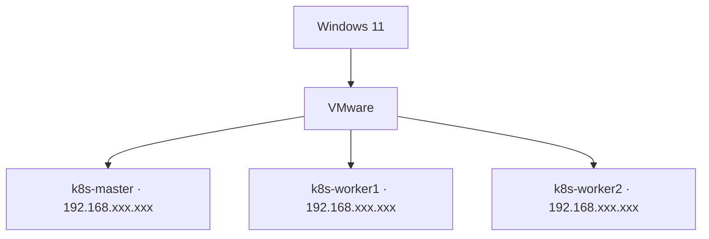

# 01 — Infrastructure and VMs

## Concept
VMware hosts three Debian 13 VMs. The control plane manages the cluster; worker nodes run application Pods.

## Recorded topology


| Node | Address | Role |
|---|---|---|
| k8s-master | 192.168.xxx.xxx | Control plane |
| k8s-worker1 | 192.168.xxx.xxx | Worker |
| k8s-worker2 | 192.168.xxx.xxx | Worker |

LAN network and gateway/DNS addresses are masked as `192.168.xxx.xxx`; interface is `ens33`. One Notion entry says addresses were DHCP-assigned; verify before calling them static.

## Implementation / checks
```bash
hostnamectl
ip -br address
ip route
cat /etc/resolv.conf
getent hosts k8s-master k8s-worker1 k8s-worker2
ping -c 3 192.168.xxx.xxx
```

Example `/etc/hosts` mappings (replace placeholders with each VM's actual address):
```text
192.168.xxx.xxx k8s-master
192.168.xxx.xxx k8s-worker1
192.168.xxx.xxx k8s-worker2
```

## Troubleshooting
Check VMware network mode, DHCP address changes, routes, host firewall, DNS and /etc/hosts. For SSH failures, verify username, sshd status, authorized_keys and permissions. Never commit private keys.
