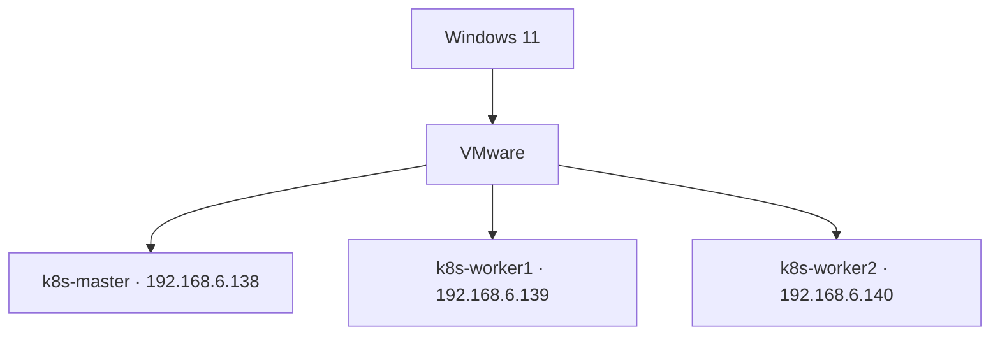

# 01 — Infrastructure and VMs

## Concept
VMware hosts three Debian 13 VMs. The control plane manages the cluster; worker nodes run application Pods.

## Recorded topology


| Node | Address | Role |
|---|---|---|
| k8s-master | 192.168.6.138 | Control plane |
| k8s-worker1 | 192.168.6.139 | Worker |
| k8s-worker2 | 192.168.6.140 | Worker |

Notes record network 192.168.6.0/24, gateway/DNS 192.168.6.2, interface ens33. One Notion entry says the addresses were DHCP-assigned; verify before calling them static.

## Implementation / checks
```bash
hostnamectl
ip -br address
ip route
cat /etc/resolv.conf
getent hosts k8s-master k8s-worker1 k8s-worker2
ping -c 3 192.168.6.139
```

Example /etc/hosts mappings:
```text
192.168.6.138 k8s-master
192.168.6.139 k8s-worker1
192.168.6.140 k8s-worker2
```

## Troubleshooting
Check VMware network mode, DHCP address changes, routes, host firewall, DNS and /etc/hosts. For SSH failures, verify username, sshd status, authorized_keys and permissions. Never commit private keys.