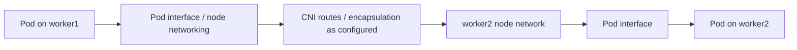

# 05 — Cluster Networking, CNI, Pod Routing and DNS

## Addressing model

This lab has three distinct address scopes:

- **Node network:** LAN addresses are masked as `192.168.xxx.xxx`; the lab uses a `/24` network. Notion says node addresses were DHCP-assigned.
- **Pod network:** `10.244.0.0/16` was configured at kubeadm init. Pod IPs are assigned by the CNI/IPAM design and are not the node addresses.
- **Service network:** ClusterIP addresses are virtual Service addresses and are not ordinary Pod addresses.

Do not assume example Pod IPs or Service IPs are stable after resources are recreated.

## CNI responsibilities

The Container Network Interface (CNI) is the plugin interface used by the runtime to configure Pod networking. The plugin and its components provide Pod interfaces/addressing and node-to-node Pod connectivity; some CNI implementations also enforce NetworkPolicy. The recorded cluster initially used Flannel. Later Notion notes describe migration to Calico v3.33.0 and NetworkPolicy exercises. Treat this as history, not a recommendation to run both at once.

The lab's early failure was:
```text
failed to find plugin "flannel" in path [/usr/lib/cni]
```
The binary was found under `/opt/cni/bin`. The containerd CRI CNI configuration was adjusted to use `bin_dir = "/opt/cni/bin"` and `conf_dir = "/etc/cni/net.d"`, then containerd was restarted. This is a specific historical fix: inspect the actual runtime configuration and active CNI before repeating it.

## Packet-flow mental model



Cross-node Pod-to-Pod connectivity is different from Service access. A Service adds a stable virtual endpoint and forwards to ready endpoints; DNS resolves names but does not itself carry the application request.

## Lab verification commands

```bash
kubectl get nodes -o wide
kubectl get pods -A -o wide
kubectl get nodes -o custom-columns=NAME:.metadata.name,POD-CIDR:.spec.podCIDR
kubectl get daemonsets -A
kubectl get pods -A | grep -Ei 'calico|flannel'
kubectl get svc,endpointslice -A
ip route
ip -br addr
```

The Notion notes record a successful cross-node test from a BusyBox Pod on worker1 to a worker2 Pod, with three replies received. Pod IPs are omitted because they are ephemeral examples.

## Kubernetes DNS

CoreDNS provides cluster DNS. The `kube-dns` Service is the stable Service name for CoreDNS in a typical kubeadm cluster; CoreDNS Pods back that Service. A normal Service DNS name follows the form:

`service-name.namespace.svc.cluster.local`

Test a name and Service path separately:
```bash
kubectl get pods -n kube-system -l k8s-app=kube-dns -o wide
kubectl get svc kube-dns -n kube-system
kubectl get endpointslice -n kube-system -l kubernetes.io/service-name=kube-dns
kubectl logs -n kube-system -l k8s-app=kube-dns
kubectl exec <client-pod> -- nslookup nginx-service.k8s-demo.svc.cluster.local
kubectl exec <client-pod> -- wget -qO- http://nginx-service.k8s-demo.svc.cluster.local
```

The client image must include the requested diagnostic tool. The CoreDNS Corefile usually includes the Kubernetes plugin and a forwarder for non-cluster queries; inspect the live ConfigMap before changing it:
```bash
kubectl get configmap coredns -n kube-system -o yaml
```

## Troubleshooting

1. **Pod stuck in ContainerCreating:** inspect Pod events, CNI DaemonSet, CNI config and binary directories, containerd and kubelet logs.
2. **Pod IP unreachable across nodes:** verify both Pods are Ready, node routing/firewall, CNI status and Pod CIDR; test one direction at a time.
3. **Service ClusterIP unreachable:** inspect Service selectors, EndpointSlices, targetPort and dataplane/kube-proxy mode.
4. **Service DNS fails but ClusterIP works:** inspect CoreDNS readiness, kube-dns Service/EndpointSlices, Pod resolver settings and CoreDNS logs.
5. **External names fail:** inspect the CoreDNS forwarding configuration and upstream DNS reachability.
6. **NetworkPolicy appears ineffective:** verify active CNI policy enforcement, namespace/pod selectors, policyTypes, port and direction.

Never install or remove CNI components as a guess on a working cluster. Confirm the active plugin and capture current configuration first.
