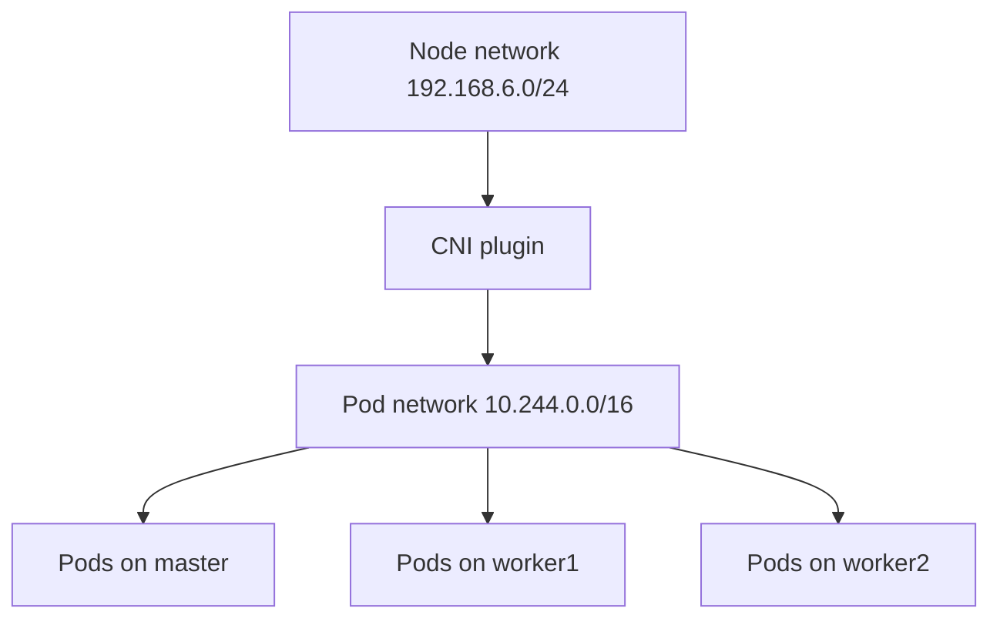

# 05 — Cluster Networking and CNI

## Concept
The CNI plugin connects Pods. The Pod CIDR recorded is 10.244.0.0/16; node IPs (192.168.6.x), Pod IPs (10.244.x.x) and Service IPs are different address ranges.

## CNI history
Initial cluster setup used Flannel. Later Notion networking notes say the cluster migrated to Calico v3.33.0, with cross-node Pod connectivity and NetworkPolicy exercises. Treat Flannel as historical and verify the active plugin before changing anything.



## Verify
```bash
kubectl get nodes -o wide
kubectl get pods -A -o wide
kubectl get nodes -o custom-columns=NAME:.metadata.name,POD-CIDR:.spec.podCIDR
kubectl get daemonsets -A
kubectl get pods -A | grep -Ei 'calico|flannel'
```

A recorded cross-node test pinged worker2 Pod 10.244.2.10 from a BusyBox Pod on worker1 (10.244.1.46), with 3/3 packets received.

## Troubleshooting
Inspect Pod events, CNI DaemonSets, containerd logs, CNI config paths, node routes and firewall rules. Test Pod IP, Service IP and DNS separately. Use a diagnostic image that includes ping/wget/nslookup.