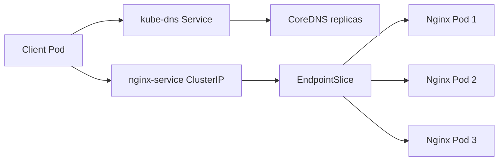

# 06 — Workloads, Services, EndpointSlices and DNS

## Concepts
Pod is the smallest workload unit; Deployment manages replicas; Service offers a stable endpoint; EndpointSlice tracks backend addresses; CoreDNS resolves service names; kube-proxy commonly programs Service networking rules.

## Nginx lab
```bash
kubectl create deployment nginx --image=nginx:latest --replicas=3
kubectl get deployment
kubectl get pods -o wide
kubectl expose deployment nginx --name=nginx-service --port=80 --target-port=80
kubectl get svc nginx-service
kubectl get endpointslice -l kubernetes.io/service-name=nginx-service
```

A historical observed ClusterIP was 10.96.96.239; recreated values may differ. A 3-replica Python HTTP echo workload was also tested behind echo-service on port 8080.

## DNS / traffic flow


Test from a suitable client Pod:
```bash
kubectl exec network-test-worker1 -- nslookup nginx-service
kubectl exec network-test-worker1 -- wget -qO- http://nginx-service:80
kubectl get pods -n kube-system -l k8s-app=kube-dns -o wide
kubectl get svc,endpointslice -n kube-system
```

## Troubleshooting
For ContainerCreating, inspect events and CNI state. For DNS failures, check CoreDNS Pods/logs, kube-dns Service, EndpointSlices, resolver config and CNI. Minimal images may not include ping or curl.