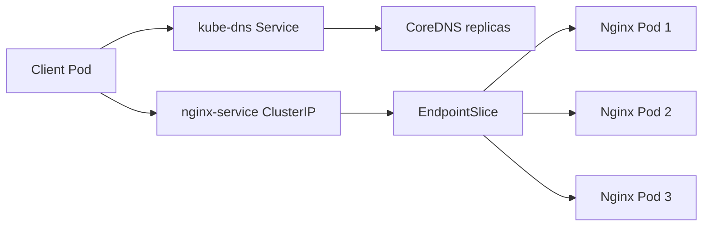

# 06 — Workloads, Services, EndpointSlices and DNS

## How the pieces fit together

- **Pod:** the smallest schedulable unit. A Pod has one or more containers that share its network namespace and can share mounted volumes. Pod IPs are replaceable.
- **Deployment:** describes a desired replica count and a Pod template. It manages ReplicaSets, rolls out changes, and replaces missing replicas. It is generally preferred over creating standalone Pods for stateless apps.
- **Labels and selectors:** labels are key/value metadata. A Deployment selector identifies its Pods; a Service selector independently finds the Pods that should receive traffic. Mismatched labels commonly cause empty backends.
- **Service:** gives clients a stable name and virtual IP even when Pod IPs change. ClusterIP is for in-cluster access; NodePort exposes a port on nodes; LoadBalancer requests an external load-balancer implementation.
- **EndpointSlice:** stores the backend addresses and port information associated with a Service. An empty or missing slice can indicate selector mismatch, unready Pods, or controller issues.
- **CoreDNS:** provides cluster DNS, allowing clients to use names instead of hard-coding Pod IPs. kube-proxy or an equivalent dataplane implements Service traffic routing depending on cluster configuration.

## YAML example

The [manifest directory](../manifests/README.md) has a three-replica Deployment and ClusterIP Service. Apply in order:
```bash
kubectl apply -f manifests/namespace.yaml
kubectl apply -f manifests/nginx-deployment.yaml
kubectl apply -f manifests/nginx-service.yaml
kubectl rollout status deployment/nginx -n k8s-demo
kubectl get deployment,replicaset,pods,svc -n k8s-demo -o wide
kubectl get endpointslice -n k8s-demo -l kubernetes.io/service-name=nginx-service
```
Run these commands from the repository root. The manifest image version and object names are examples; check compatibility and existing names first.

## DNS and traffic flow



Test from a suitable client Pod:
```bash
kubectl exec network-test-worker1 -- nslookup nginx-service.k8s-demo.svc.cluster.local
kubectl exec network-test-worker1 -- wget -qO- http://nginx-service.k8s-demo.svc.cluster.local
kubectl get pods -n kube-system -l k8s-app=kube-dns -o wide
kubectl get svc,endpointslice -n k8s-demo
```
The client Pod must exist and have the required tools. Some minimal images do not include `ping`, `curl` or `nslookup`.

## Troubleshooting sequence

1. `kubectl get pods -n k8s-demo -o wide` — are Pods scheduled and Ready?
2. `kubectl describe pod <pod> -n k8s-demo` — inspect events and probe failures.
3. `kubectl get svc nginx-service -n k8s-demo -o yaml` — does the selector match Pod labels?
4. `kubectl get endpointslice -n k8s-demo -l kubernetes.io/service-name=nginx-service` — are backend addresses present?
5. Test direct Pod IP, then Service DNS and Service IP to isolate whether the fault is app, Service networking or DNS.
6. For `ContainerCreating`, inspect CNI state and kubelet/containerd events; for DNS failures, inspect CoreDNS logs, Service endpoints, resolver configuration and CNI.

The lab previously observed a ClusterIP of `10.96.96.239`; Kubernetes can assign a different address when resources are recreated.
