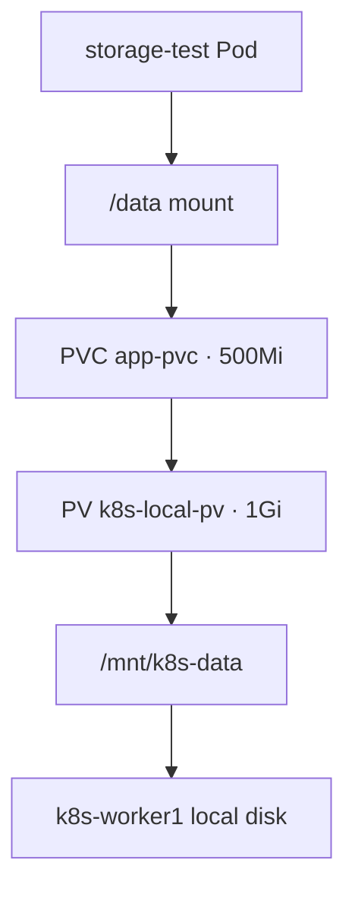

# 08 — PersistentVolumes and PersistentVolumeClaims

## Storage concepts

- **Ephemeral container filesystem:** data written only to a container's writable layer can disappear when the container is replaced.
- **PersistentVolume (PV):** a cluster resource describing storage available for workloads.
- **PersistentVolumeClaim (PVC):** a namespaced request for a capacity and access mode. Kubernetes binds a compatible PV to the claim.
- **Mount:** a Pod references the PVC and mounts it at a path such as `/data`; the application reads/writes files at that mount.
- **Access mode:** for example, `ReadWriteOnce` indicates the volume can be mounted read-write by a single node at a time (not necessarily only one Pod). It does not by itself guarantee backups or high availability.
- **Reclaim policy:** `Retain` keeps the underlying storage after a claim is released; an administrator must handle its lifecycle.

## Lab implementation recorded

- Host directory: `/mnt/k8s-data` on worker1
- PV: `k8s-local-pv`, 1Gi, `Retain` policy
- PVC: `app-pvc`, 500Mi
- A test Pod mounted the claim at `/data`, wrote a file, was recreated, and the file was still present.

The [storage-pv-pvc.yaml](../manifests/storage-pv-pvc.yaml) manifest uses a node-affined local volume. It assumes the path exists on node `k8s-worker1`; prepare and permission-check that node before applying. A PVC in `k8s-demo` refers to the cluster-scoped PV.

## Data flow



## Verify

```bash
kubectl get pv
kubectl get pvc -n k8s-demo
kubectl describe pvc app-pvc -n k8s-demo
kubectl get pod -n k8s-demo -o wide
```
After mounting the claim in a test Pod, write a harmless test file, delete/recreate that Pod, and confirm the file remains. Pod recreation is not the same as node-failure recovery.

## Limitations

`hostPath` and local PVs are tied to a node and its disk. If that node or disk is lost, the workload may not be able to access the data. They are useful for learning but are not a substitute for replicated storage, backups or disaster recovery. Use restrictive filesystem ownership and permissions; do not copy broad lab permissions into production.
