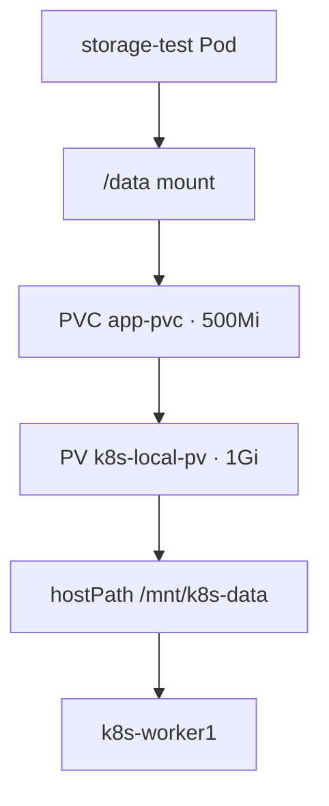

# 08 — PersistentVolumes and PersistentVolumeClaims

## Concept
A PV represents storage; a PVC requests storage. A Pod mounts the claim so data can survive Pod replacement.

## Lab implementation recorded
- hostPath directory: /mnt/k8s-data on worker1
- PV: k8s-local-pv, 1Gi, Retain policy
- PVC: app-pvc, 500Mi
- Test Pod mounted the claim at /data, wrote a file, then recreated the Pod and verified the file remained.



## Verify
```bash
kubectl get pv
kubectl get pvc
kubectl describe pvc app-pvc
kubectl exec storage-test -- cat /data/message.txt
```

## Caveat
hostPath is node-specific and not resilient production storage. Broad permissions used in a lab should not be copied into production; set restrictive ownership and permissions.