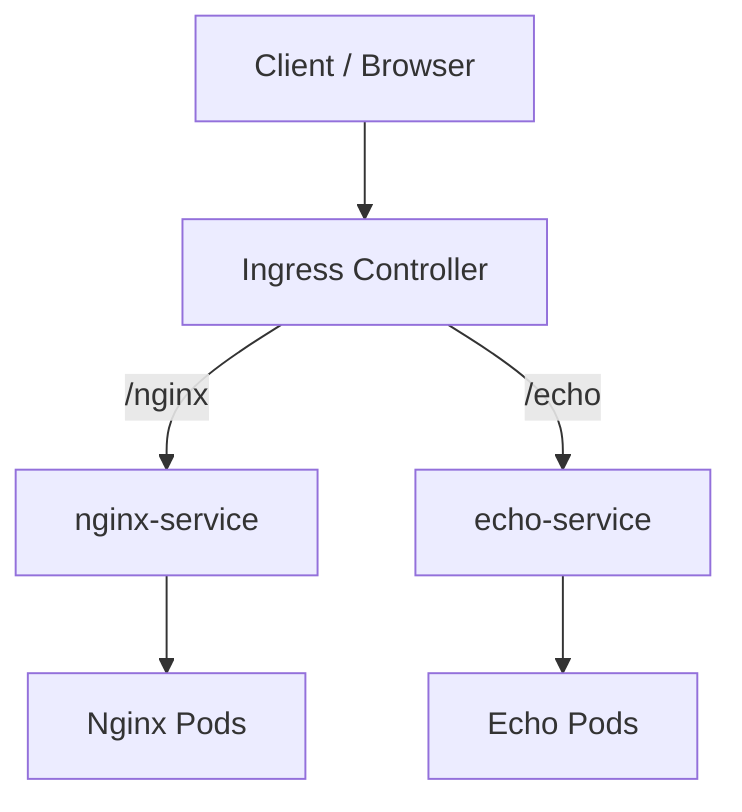

# 09 — Ingress

## Concept
Ingress declares HTTP/HTTPS routing rules; an Ingress Controller must be installed to implement them. The controller routes to Services, which route to ready Pods.



## Inspect
```bash
kubectl get ingress -A
kubectl get ingressclass
kubectl get pods -A | grep -i ingress
kubectl get svc -A | grep -i ingress
```

The notes describe checking/installing ingress-nginx. Verify the controller, version, IngressClass, Service exposure and rules in the live cluster before reapplying manifests.

## Troubleshooting
404: inspect host/path rules. 502/503: inspect backend Service selectors, EndpointSlices, Pod readiness and targetPort. No external access: inspect controller Service, DNS, firewall and NodePort/load-balancer setup. Never commit private TLS keys.