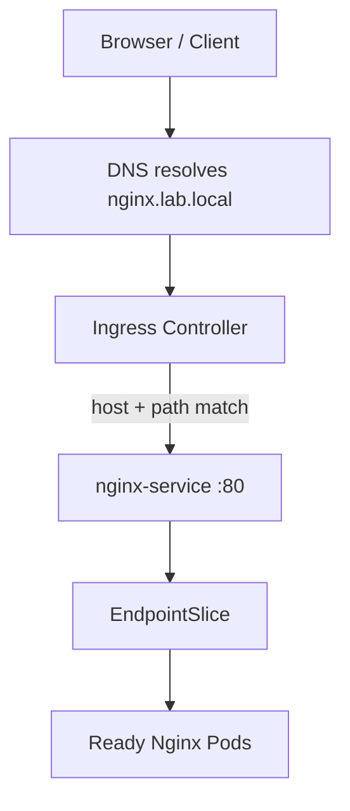

# 09 — Ingress

## Ingress vs Service

A **Service** gives a stable endpoint to a set of Pods. An **Ingress** is an API resource describing HTTP/HTTPS rules such as hostnames and URL paths. An **Ingress Controller** is the running implementation that watches Ingress resources and configures the actual proxy. Creating an Ingress object alone does not install a controller or make an application reachable.

## Request flow



The [ingress.yaml](../manifests/ingress.yaml) template uses host `nginx.lab.local`, IngressClass `nginx` and Service `nginx-service` in `k8s-demo`. It only works if the matching controller is installed and exposed, the Service exists, and the client can resolve/reach the hostname. For a local lab, DNS or a hosts-file entry may be needed.

## Inspect before applying

```bash
kubectl get ingress -A
kubectl get ingressclass
kubectl get pods -A | grep -i ingress
kubectl get svc -A | grep -i ingress
kubectl describe ingress nginx-ingress -n k8s-demo
```

The notes describe checking/installing ingress-nginx. Verify controller version, class name, Service exposure, DNS, and rules against the live cluster before applying the template. Ingress API behavior depends on the installed controller and its configuration.

## Troubleshooting

- **404:** verify hostname and path rules and that the request reaches the intended controller.
- **502/503:** inspect backend Service selector, EndpointSlices, Pod readiness and target port.
- **No external access:** inspect controller Service type, node firewall, routing, DNS and any required NodePort/load-balancer setup.
- **TLS problems:** verify the TLS Secret reference and certificate chain. Never commit private TLS keys or real certificate private material.
