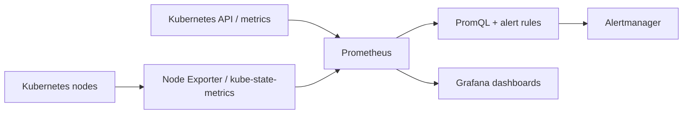

# 14 — Observability: Prometheus, Grafana, PromQL and Alertmanager

## What the lab covered

Notion records a Prometheus/Grafana monitoring stack, Kubernetes dashboards, PromQL queries, custom PrometheusRule alerts for high CPU, high memory and Pods not Ready, and a CPU load test. Metrics Server was investigated separately because Prometheus does not automatically expose the Kubernetes Metrics API used by `kubectl top` and standard HPA resource metrics.

## Architecture



- **Prometheus** scrapes and stores time-series metrics and evaluates alerting rules.
- **Node Exporter** exposes host-level metrics such as CPU and memory.
- **kube-state-metrics** exposes metrics derived from Kubernetes object state, such as Pod readiness and Deployment replica status.
- **Grafana** queries data sources such as Prometheus and renders dashboards. It is a visualization layer, not the metrics database.
- **PromQL** selects and aggregates time-series data.
- **Alertmanager** groups, deduplicates, routes and silences alerts emitted by Prometheus.
- **Metrics Server** supplies resource metrics to the Kubernetes Metrics API for `kubectl top` and resource-metric HPA. It is distinct from Prometheus.

## Useful commands

```bash
kubectl get pods -n monitoring
kubectl get svc -n monitoring
kubectl get prometheusrule -n monitoring
kubectl port-forward -n monitoring svc/monitoring-kube-prometheus-prometheus 9090:9090
kubectl top nodes
kubectl top pods -A
```

Port-forward names vary by Helm release; list Services first and use the actual name. `kubectl top` fails with `Metrics API not available` when Metrics Server or its API integration is unavailable, even if Prometheus is collecting metrics successfully.

## PromQL examples

These are common query patterns; exact metric names depend on the installed exporters and monitoring chart.

```promql
# CPU usage rate by node
sum by (instance) (rate(node_cpu_seconds_total{mode!="idle"}[5m]))

# Memory available on hosts
node_memory_MemAvailable_bytes

# Top 5 Pods by container CPU usage (requires compatible cAdvisor labels)
topk(5, sum by (namespace, pod) (rate(container_cpu_usage_seconds_total{container!=""}[5m])))

# Count Pods that are not Ready (metric names/labels depend on kube-state-metrics version)
sum by (namespace) (kube_pod_status_ready{condition="true"} == 0)
```

PromQL mental model: select a metric, filter labels, apply a range function such as `rate()` if needed, aggregate with `sum by (...)`, and visualize or use the result in an alert expression.

## PrometheusRule example

See [high-cpu-alert.yaml](../manifests/high-cpu-alert.yaml). It is a template for a Prometheus Operator installation; the CRD must exist before applying it. Tune thresholds to the actual node capacity and confirm the metric labels in Prometheus first.

## Troubleshooting notes

- **No data in Grafana:** check the data source URL, Prometheus targets, scrape errors, time range and metric labels.
- **No PrometheusRule resource:** verify the Prometheus Operator CRD with `kubectl get crd prometheusrules.monitoring.coreos.com`.
- **Rule exists but alert never fires:** run its PromQL expression directly, verify metric labels, threshold, duration and rule selection.
- **No notifications:** inspect Alertmanager configuration, routes, receivers and logs. An alert firing does not guarantee an external notification is configured.
- **`kubectl top` unavailable:** check Metrics Server Deployment, APIService and logs separately from Prometheus.

## What was verified vs configuration to re-check

Notion records dashboards, PromQL practice, PrometheusRule creation and CPU load generation. Monitoring component names, exact queries and alert thresholds can change between releases, so inspect the live installation before reapplying manifests.
