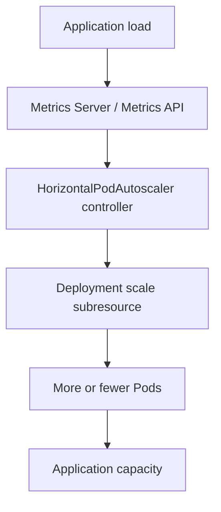

# 15 — Resource Management, QoS and Horizontal Pod Autoscaling

## Requests vs limits

- **CPU request:** scheduler placement input and a reservation used by resource accounting; CPU can be throttled at a configured limit.
- **Memory request:** scheduler placement input. It does not reserve a hard physical partition.
- **CPU limit:** caps CPU time available to the container; reaching it commonly causes throttling, not container termination.
- **Memory limit:** a hard cgroup limit; exceeding it can result in an OOM kill.
- **QoS class:** Kubernetes assigns Guaranteed, Burstable or BestEffort based on container resource requests/limits. QoS influences eviction priority under node pressure; it does not replace resource planning.

## HPA architecture



HPA periodically compares observed metrics with targets and adjusts a workload's replica count within configured bounds. CPU utilization targets are calculated relative to CPU requests, so requests should be defined. HPA does not create extra node capacity; Pods may remain Pending if nodes lack resources.

## Lab commands

```bash
kubectl top nodes
kubectl top pods -A
kubectl get hpa -A
kubectl describe hpa hpa-demo
kubectl get deployment hpa-demo
kubectl get pods -l app=hpa-demo -o wide
kubectl get apiservice v1beta1.metrics.k8s.io
```

Notion records installing Metrics Server, validating the APIService, creating an HPA demo, observing scale-up/scale-down and finding that worker-side kubectl lacked a kubeconfig and defaulted to localhost:8080. Use least-privilege kubeconfig credentials when remote kubectl access is needed; do not copy the admin kubeconfig to every node.

## YAML examples

- [hpa-demo.yaml](../manifests/hpa-demo.yaml) includes resource requests/limits.
- [hpa.yaml](../manifests/hpa.yaml) defines a CPU target and min/max replicas.
- [resource-qos-demo.yaml](../manifests/resource-qos-demo.yaml) illustrates a bounded workload.

Apply the HPA only after the Metrics API is working and the target Deployment exists. The target CPU percentage is relative to CPU requests.

## Troubleshooting

- HPA shows `<unknown>`: inspect Metrics Server, APIService and Pod resource requests.
- Replicas do not increase: inspect HPA events, current/desired metrics, target workload, CPU load and min/max bounds.
- Pods are Pending after scale-up: inspect scheduler events and node allocatable capacity.
- Container is OOMKilled: inspect `kubectl describe pod`, previous logs and memory limit; do not assume CPU is the cause.
- CPU looks low in `kubectl top` but Prometheus has data: verify the Metrics API independently; these are different data paths.
