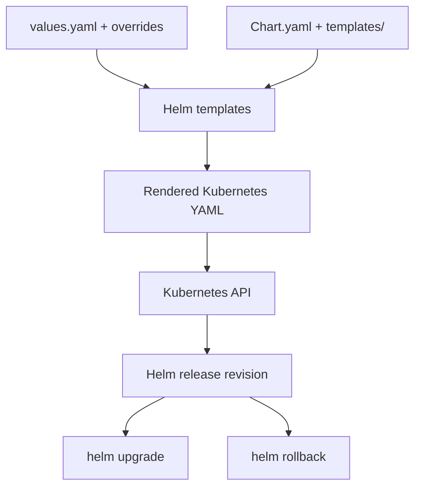

# 16 — Helm: Charts, Values, Releases, Upgrades and Rollback

## Concepts

- **Chart:** a package of Kubernetes templates and metadata.
- **Chart.yaml:** chart name, version and metadata.
- **values.yaml:** default configuration values.
- **Templates:** Kubernetes manifests with placeholders and control structures.
- **Release:** one installed instance of a chart with a release name and revision history.
- **Upgrade:** renders new configuration and updates the release.
- **Rollback:** returns a release to a previous revision.
- **Uninstall:** removes resources managed by the release; understand which persistent resources may be retained before cleanup.

## Architecture



## Useful commands

```bash
helm version
helm create web-demo
helm lint ./web-demo
helm template web-demo ./web-demo
helm install web-demo ./web-demo --dry-run --debug
helm install web-demo ./web-demo
helm list -A
helm get values web-demo
helm history web-demo
helm upgrade web-demo ./web-demo
helm rollback web-demo 1
helm uninstall web-demo
```

Use the actual chart path and release name from your lab. `helm create` generates a starter chart; inspect templates and values before installing.

## Lab coverage

Notion records chart creation, Chart.yaml and values.yaml concepts, template rendering, release installation, custom replica values, upgrades, revision history, rollback to an earlier revision, and uninstall/cleanup. The root Notion notes also include a second upgrade scenario.

## Troubleshooting

- **Template rendering errors:** run `helm lint` and `helm template`; check YAML indentation and values types.
- **Upgrade fails:** inspect Helm output, then `helm history` and `helm status`; validate rendered manifests before retrying.
- **Rollback appears ineffective:** compare revisions and rendered/resource state; remember a rollback creates a new history entry.
- **Chart installs but Pods fail:** Helm can successfully submit manifests while Kubernetes workloads still fail. Inspect Pods, events, image pulls, probes and resources.
- **Uninstall leaves data:** PersistentVolumes and PVCs may have reclaim/retention behavior independent of normal workload cleanup.

A small illustrative chart is included under [charts/web-demo](../charts/web-demo/Chart.yaml). It is an example, separate from the exact historical chart used in the lab.
