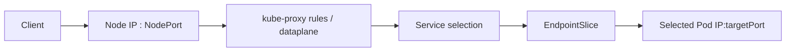
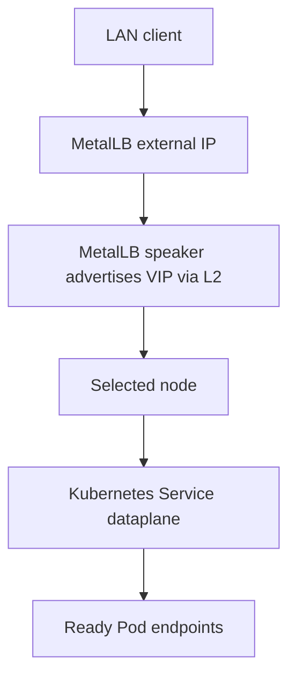

# 17 — Kubernetes Service Types and Packet Flow

## Service types

- **ClusterIP:** internal virtual IP; default Service type.
- **NodePort:** exposes the Service through a port on each node and still retains a ClusterIP.
- **LoadBalancer:** requests an external load balancer implementation. In cloud environments a cloud integration may provide it; in this VMware lab, MetalLB supplied it.
- **ExternalName:** DNS alias behavior, not proxying to a selected Pod endpoint.

## Lab results recorded in Notion

- Inspected ClusterIP forwarding through kube-proxy iptables chains.
- Traced `KUBE-NODEPORTS`, `KUBE-EXT-*`, `KUBE-SVC-*` and `KUBE-SEP-*` to endpoint DNAT.
- Verified cross-node NodePort traffic with `externalTrafficPolicy: Cluster`.
- Installed MetalLB v0.15.3 in Layer 2 mode.
- Configured pool `192.168.6.200-192.168.6.210` with an `IPAddressPool` and `L2Advertisement`.
- Verified a LoadBalancer Service received `192.168.6.200`, with a NodePort allocated as well.

Treat those addresses and generated chain names as historical observations; they can differ in the current cluster.

## Traffic diagrams





MetalLB handles IP allocation/advertisement; it does not replace the Kubernetes Service dataplane. In Layer 2 mode, eligible speakers advertise the VIP on the local network (IPv4 ARP). Ensure the pool is reserved and not used by DHCP or other devices.

## Useful commands

```bash
kubectl get svc -A -o wide
kubectl get endpointslice -A
kubectl get pods -n metallb-system -o wide
kubectl get ipaddresspools,l2advertisements -n metallb-system
kubectl describe svc svc-lb-test-service
sudo iptables -t nat -L KUBE-NODEPORTS -n -v
ip neigh show
```

Kube-proxy mode and chains depend on the cluster. Do not assume iptables chain names exist in clusters using another dataplane or proxy mode.

## Troubleshooting

- Service has no endpoints: compare Service selector to Pod labels and check readiness.
- NodePort unreachable: check the NodePort, node firewall, route, kube-proxy/dataplane and backend readiness.
- LoadBalancer stays pending: check whether a cloud provider or MetalLB is installed and configured.
- MetalLB IP does not respond: verify pool allocation, L2Advertisement, speaker readiness, ARP/neighbour resolution, address conflicts and VLAN/L2 reachability.
- Traffic reaches a wrong backend: inspect host/path routing, Service targetPort, EndpointSlice and readiness.
