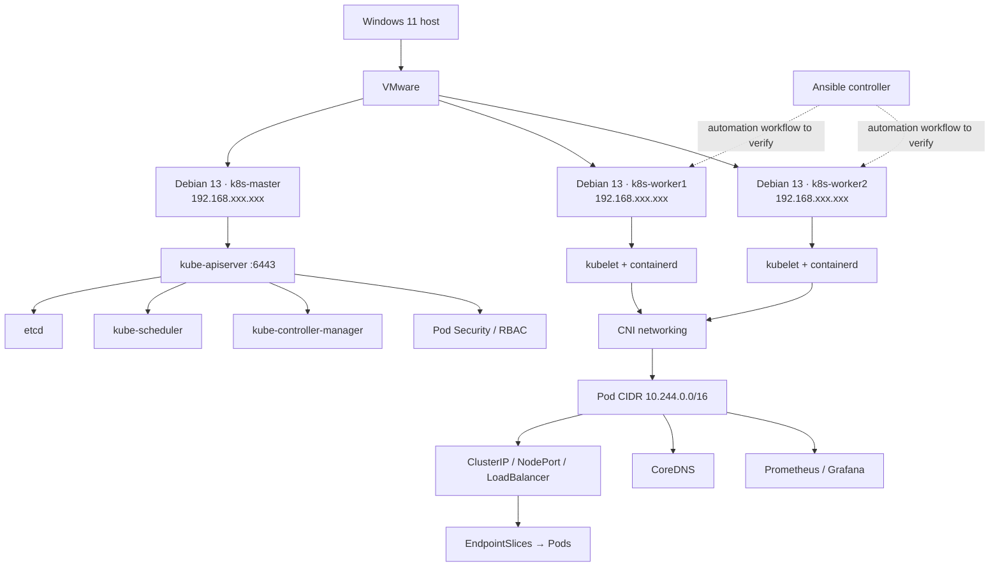

# Kubernetes Cluster Lab — Build, Networking, Security & Automation

A hands-on Kubernetes administration lab built on VMware with three Debian 13 virtual machines. This repository consolidates the Notion lab record into concepts, commands, reusable YAML, troubleshooting guides and architecture diagrams.

## Architecture

### Recorded node inventory

| Node | Recorded address | Role |
|---|---|---|
| `k8s-master` | `192.168.xxx.xxx` | Control plane |
| `k8s-worker1` | `192.168.xxx.xxx` | Worker |
| `k8s-worker2` | `192.168.xxx.xxx` | Worker |

Recorded settings: LAN network `192.168.xxx.xxx/24`, gateway/DNS `192.168.xxx.xxx`, interface `ens33`, Kubernetes `v1.34.12`, containerd `1.7.24`, Pod CIDR `10.244.0.0/16`. LAN addresses have been masked for privacy; replace placeholders with your own values before running commands.

## Complete guide and configuration cookbook

- [Configuration Cookbook](docs/CONFIGURATION_COOKBOOK.md) — node preparation, containerd, Kubernetes installation, kubeadm initialization, CNI checks, workload troubleshooting, ConfigMaps/Secrets, storage, Ingress, Helm, monitoring, RBAC and NetworkPolicy commands.
- Source reference: the supplied *Kubernetes Cluster on VMware — Complete Lab Guide, Topics 1–61* PDF was used to organize this cookbook. The repository's numbered topic guides and manifests remain the detailed, browsable implementation examples.

## Documentation index

| Directory | Topics |
|---|---|
| [01-infrastructure](01-infrastructure/README.md) | VMware, Debian VMs, users, hostnames, addressing and SSH |
| [02-linux-prerequisites](02-linux-prerequisites/README.md) | Swap, kernel modules, sysctl and packet forwarding |
| [03-container-runtime](03-container-runtime/README.md) | containerd, CRI, systemd cgroups and CNI binary paths |
| [04-kubernetes-installation](04-kubernetes-installation/README.md) | APT repository, kubeadm, kubelet, kubectl, init and worker join |
| [05-cluster-networking](05-cluster-networking/README.md) | Pod CIDR, Flannel-to-Calico history, Pod connectivity and DNS |
| [06-workloads-and-services](06-workloads-and-services/README.md) | Pods, Deployments, Services, EndpointSlices, CoreDNS |
| [07-configuration-and-secrets](07-configuration-and-secrets/README.md) | ConfigMaps and Secrets |
| [08-persistent-storage](08-persistent-storage/README.md) | PV/PVC, hostPath and StatefulSet storage concepts |
| [09-ingress](09-ingress/README.md) | ingress-nginx, path and host-based routing |
| [10-security-and-rbac](10-security-and-rbac/README.md) | Pod Security Admission, RBAC, ClusterRole and NetworkPolicy |
| [11-automation-ansible](11-automation-ansible/README.md) | Ansible inventory and worker automation workflow |
| [12-troubleshooting](12-troubleshooting/README.md) | Runtime, CNI, DNS, Pod, Service and access troubleshooting |
| [13-validation-and-interview](13-validation-and-interview/README.md) | Verification checklist and interview summaries |
| [14-observability](14-observability/README.md) | Prometheus, Grafana, PromQL, PrometheusRule and Alertmanager |
| [15-scaling-and-resources](15-scaling-and-resources/README.md) | Metrics Server, HPA, resource requests/limits, QoS and OOM |
| [16-helm](16-helm/README.md) | Charts, templates, values, install, upgrade, rollback and uninstall |
| [17-service-types-and-networking](17-service-types-and-networking/README.md) | ClusterIP, NodePort, LoadBalancer, kube-proxy, iptables and MetalLB |
| [18-workload-controllers-and-probes](18-workload-controllers-and-probes/README.md) | StatefulSets, DaemonSets, Jobs, CronJobs, probes, taints/tolerations |
| [manifests](manifests/README.md) | Reusable Kubernetes YAML examples |
| [charts/web-demo](charts/web-demo/Chart.yaml) | Small illustrative Helm chart |
| [diagrams](diagrams/README.md) | Mermaid diagrams |
| [SOURCES.md](SOURCES.md) | Notion source pages and accuracy notes |

## What the lab covered

### Cluster foundation
- Created three Debian 13 VMs in VMware, configured Linux users, hostnames, `/etc/hosts`, swap, kernel modules and sysctl networking.
- Installed containerd 1.7.24 and fixed its CRI configuration, including `SystemdCgroup = true`.
- Installed Kubernetes v1.34.12 components, initialized the control plane with kubeadm, configured kubectl and joined both workers.
- Troubleshot the CNI binary path mismatch (`/usr/lib/cni` versus `/opt/cni/bin`).

### Workloads, networking and storage
- Deployed Nginx and a three-replica Python HTTP test application.
- Tested ClusterIP Services, EndpointSlices, CoreDNS service discovery, Pod IP connectivity and cross-node traffic.
- Practised ConfigMaps, Secret references, PV/PVC persistence, Ingress path and host routing.
- Deep-dived into kube-proxy iptables chains, NodePort cross-node routing and LoadBalancer behavior using MetalLB Layer 2 mode.
- Practised NetworkPolicy isolation and Calico-related networking.

### Operations, delivery and scaling
- Created Helm charts, rendered templates, installed releases, changed values, upgraded, rolled back and uninstalled releases.
- Worked with Prometheus/Grafana dashboards, PromQL, alert rules and Alertmanager concepts.
- Installed Metrics Server, used `kubectl top`, tested HPA scale-up/scale-down, and explored resource requests, limits, QoS and OOM behavior.
- Documented StatefulSets, DaemonSets, Jobs, CronJobs, liveness/readiness/startup probes, taints/tolerations and node selection.
- Tested namespace-scoped RBAC, ClusterRole/ClusterRoleBinding and allowed/denied actions.

## YAML and Helm examples

Start with [manifests/README.md](manifests/README.md). Examples cover Deployments, Services, ConfigMaps, a Secret template, restricted Pod settings, PV/PVC, NetworkPolicy, RBAC, Ingress, probes, HPA, resource limits, PrometheusRule, StatefulSet, DaemonSet, Job/CronJob and scheduling tolerations. A minimal Helm chart lives in [charts/web-demo](charts/web-demo/Chart.yaml).

**Do not apply every file at once.** Some manifests require CRDs, a specific CNI, Metrics Server, a Prometheus Operator, a default StorageClass, an Ingress Controller, MetalLB, a node label/taint, or a prepared local storage path. Read the manifest README and each file's comments first. IP placeholders in examples must be replaced with valid addresses before applying.

## Accuracy and safety

- The early CNI was Flannel. Later notes describe a migration to Calico v3.33.0. Verify the active CNI before changing anything; do not install both based only on this history.
- The MetalLB address range has been masked. Choose a range reserved for the lab and excluded from DHCP before applying the example.
- LAN addresses are masked in this public repository.
- Ansible is documented as a workflow to verify, not a claim that all worker configuration was successfully automated.
- Lab YAML files are educational templates, not proof every object remains deployed.
- Never commit kubeconfig files, join tokens, private SSH keys, passwords or real Secret values.
- Base64 is encoding, not encryption. `hostPath` is node-local and not production-grade resilient storage.

## Sources

See [SOURCES.md](SOURCES.md) for links to the Notion lab notes, including the Services and Networking deep dives.
