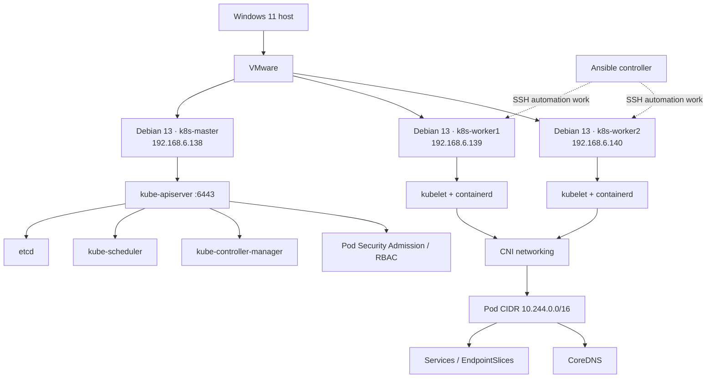

# Kubernetes Cluster Lab — Build, Networking, Security & Automation

A hands-on Kubernetes administration lab built on VMware with three Debian 13 virtual machines. This repository documents the architecture, concepts, YAML manifests, commands, validation and troubleshooting.

## Architecture

### Recorded node inventory

| Node | Recorded address | Role |
|---|---|---|
| `k8s-master` | `192.168.6.138` | Control plane |
| `k8s-worker1` | `192.168.6.139` | Worker |
| `k8s-worker2` | `192.168.6.140` | Worker |

Recorded settings: network `192.168.6.0/24`, gateway/DNS `192.168.6.2`, interface `ens33`, Kubernetes `v1.34.12`, containerd `1.7.24`, Pod CIDR `10.244.0.0/16`. One note says the addresses were DHCP-assigned, so verify live addressing before describing them as static.

## Repository guide

| Directory | Contents |
|---|---|
| [01-infrastructure](01-infrastructure/README.md) | VMware, Debian VMs, addressing and SSH |
| [02-linux-prerequisites](02-linux-prerequisites/README.md) | Swap, kernel modules, sysctl and networking |
| [03-container-runtime](03-container-runtime/README.md) | containerd, CRI, systemd cgroups and CNI paths |
| [04-kubernetes-installation](04-kubernetes-installation/README.md) | APT repository, kubeadm, kubelet, kubectl and initialization |
| [05-cluster-networking](05-cluster-networking/README.md) | Pod CIDR, CNI history, Flannel/Calico and connectivity |
| [06-workloads-and-services](06-workloads-and-services/README.md) | Pods, Deployments, Services, EndpointSlices and DNS |
| [07-configuration-and-secrets](07-configuration-and-secrets/README.md) | ConfigMaps and Secrets |
| [08-persistent-storage](08-persistent-storage/README.md) | PV/PVC and hostPath persistence |
| [09-ingress](09-ingress/README.md) | HTTP routing and Ingress Controller |
| [10-security-and-rbac](10-security-and-rbac/README.md) | Pod Security, RBAC and NetworkPolicy |
| [11-automation-ansible](11-automation-ansible/README.md) | Ansible inventory and worker automation pattern |
| [12-troubleshooting](12-troubleshooting/README.md) | Troubleshooting cases |
| [13-validation-and-interview](13-validation-and-interview/README.md) | Validation checklist and interview summary |
| [manifests](manifests/README.md) | Reusable YAML examples and concept explanations |
| [diagrams](diagrams/README.md) | Mermaid architecture diagrams |
| [SOURCES.md](SOURCES.md) | Related Notion notes and accuracy caveats |

## Core concepts

- **Control plane:** the API server is the entry point; etcd stores cluster state; the scheduler selects nodes for unscheduled Pods; controllers reconcile actual state toward desired state.
- **Worker node:** kubelet communicates with the API server and manages Pods; containerd runs containers; the CNI plugin provides Pod networking.
- **Declarative YAML:** you describe the desired state in manifests. `kubectl apply` submits it to the API; controllers continuously work to reconcile the cluster.
- **Pod / Deployment:** a Pod is the unit Kubernetes schedules. A Deployment manages ReplicaSets and replaces failed or outdated replicas.
- **Service / EndpointSlice / DNS:** a Service provides a stable virtual address; EndpointSlices list eligible backends; CoreDNS makes service names discoverable.
- **Storage:** a PVC requests storage and binds to a PV. Node-local `hostPath` data can persist across Pod recreation but is not resilient if the node or its disk fails.
- **Security:** RBAC governs API permissions, Pod security controls constrain container behavior, and NetworkPolicy can restrict Pod traffic when the CNI enforces it.

## Work covered

- Built a three-node kubeadm cluster using containerd and configured Linux prerequisites.
- Installed CNI networking and investigated plugin-path errors.
- Deployed Nginx and a Python HTTP test workload; checked Services, EndpointSlices, CoreDNS and cross-node Pod connectivity.
- Practiced ConfigMaps, Secrets, PV/PVC, Ingress, Pod Security Admission, RBAC and NetworkPolicy.
- Documented a planned Ansible workflow for repeatable worker preparation.

## YAML manifests

Start with [manifests/README.md](manifests/README.md). The examples include Namespace, Deployment, Service, ConfigMap, Secret template, restricted Pod, PV/PVC, NetworkPolicy, RBAC and Ingress. They are learning examples, not proof that each object is currently deployed. Review environment-specific assumptions before applying.

## CNI history and safety

The earlier setup used **Flannel**. Later Notion notes describe migration to **Calico v3.33.0** and NetworkPolicy exercises. These are historical stages, not an assertion that both CNI plugins are active. Verify the current cluster before changing anything.

Never commit kubeconfig files, join tokens, private SSH keys, passwords or real Secret values. Base64 is encoding, not encryption. `hostPath` is a node-local lab approach, not production-grade storage. Ansible automation remains a workflow to verify rather than a claimed completed deployment.

## Sources

See [SOURCES.md](SOURCES.md) for the related Notion Kubernetes Setup notes.
