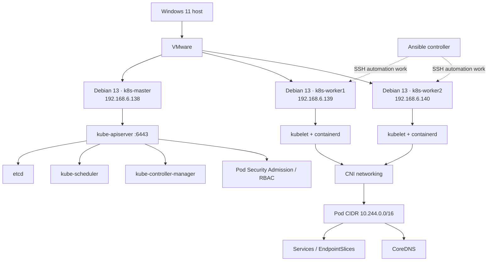

# Kubernetes Cluster Lab — Build, Networking, Security & Automation

A hands-on Kubernetes administration lab built on VMware with three Debian 13 virtual machines. This repository documents concepts, implementation commands, validation, troubleshooting and architecture diagrams in Markdown.

## Architecture

### Recorded node inventory

| Node | Recorded address | Role |
|---|---|---|
| `k8s-master` | `192.168.6.138` | Control plane |
| `k8s-worker1` | `192.168.6.139` | Worker |
| `k8s-worker2` | `192.168.6.140` | Worker |

The notes record network `192.168.6.0/24`, gateway/DNS `192.168.6.2`, interface `ens33`, Kubernetes `v1.34.12`, containerd `1.7.24`, and Pod CIDR `10.244.0.0/16`. One Notion entry says these addresses were DHCP-assigned; verify the live configuration before calling them static.

## Topic guide

| Directory | Topics |
|---|---|
| [01-infrastructure](01-infrastructure/README.md) | VMware, Debian VMs, addressing and SSH |
| [02-linux-prerequisites](02-linux-prerequisites/README.md) | Swap, kernel modules, sysctl and networking |
| [03-container-runtime](03-container-runtime/README.md) | containerd, CRI, systemd cgroups and CNI paths |
| [04-kubernetes-installation](04-kubernetes-installation/README.md) | APT repository, kubeadm, kubelet, kubectl and cluster initialization |
| [05-cluster-networking](05-cluster-networking/README.md) | Pod CIDR, CNI history, Flannel/Calico and connectivity |
| [06-workloads-and-services](06-workloads-and-services/README.md) | Deployments, Nginx, Services, EndpointSlices and CoreDNS |
| [07-configuration-and-secrets](07-configuration-and-secrets/README.md) | ConfigMaps and Secrets |
| [08-persistent-storage](08-persistent-storage/README.md) | PV/PVC and hostPath persistence test |
| [09-ingress](09-ingress/README.md) | Ingress routing and troubleshooting |
| [10-security-and-rbac](10-security-and-rbac/README.md) | Pod Security Admission, Restricted profile, RBAC and NetworkPolicy |
| [11-automation-ansible](11-automation-ansible/README.md) | Ansible inventory and worker automation pattern |
| [12-troubleshooting](12-troubleshooting/README.md) | Troubleshooting cases from the lab |
| [13-validation-and-interview](13-validation-and-interview/README.md) | Validation checklist and interview summary |
| [diagrams](diagrams/README.md) | Editable Mermaid diagrams |
| [SOURCES.md](SOURCES.md) | Related Notion pages and accuracy notes |

## Work covered

- Built a three-node kubeadm cluster using containerd.
- Configured Linux prerequisites and systemd cgroups.
- Installed CNI networking and investigated plugin-path errors.
- Deployed Nginx and a Python HTTP test workload.
- Exposed workloads through ClusterIP Services and checked EndpointSlices.
- Verified CoreDNS service discovery and cross-node Pod connectivity.
- Practiced ConfigMaps, Secrets, PV/PVC, Ingress, Pod Security Admission, RBAC and NetworkPolicy topics as recorded in Notion.
- Planned Ansible-based repeatable worker-node preparation.

## CNI history and accuracy

The earlier setup used **Flannel**. Later Notion networking notes describe a migration to **Calico v3.33.0** and successful NetworkPolicy exercises. This repository records that progression rather than implying both are active simultaneously. Confirm the live cluster before changing or documenting the active CNI.

Ansible automation is documented as a workflow to verify; do not describe it as completed until a successful playbook run has been confirmed. Likewise, re-check the live cluster before assuming historical resource names or IP addresses still exist.

## Security

- Never commit kubeconfig files, join tokens, private SSH keys, passwords or real Secret values.
- Base64 is encoding, not encryption.
- `hostPath` is a node-local learning setup, not resilient production storage.
- Use least privilege and verify security controls before applying changes.

## Sources

See [SOURCES.md](SOURCES.md) for links to the Notion Kubernetes Setup notes used to consolidate this documentation.
