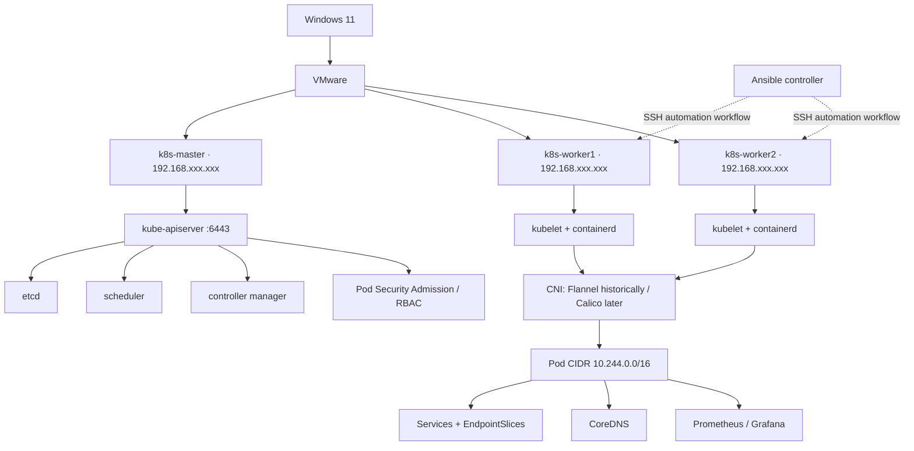
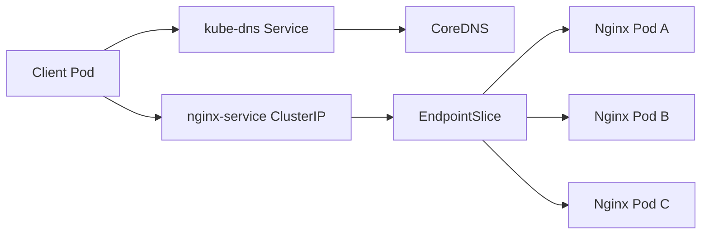
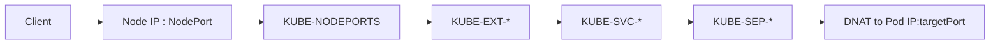
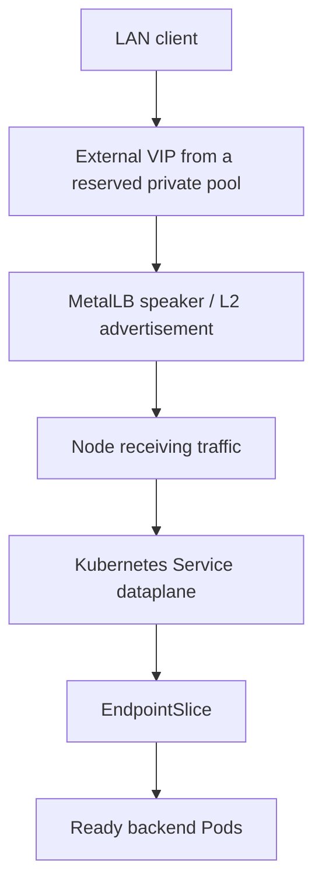
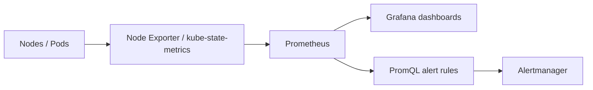
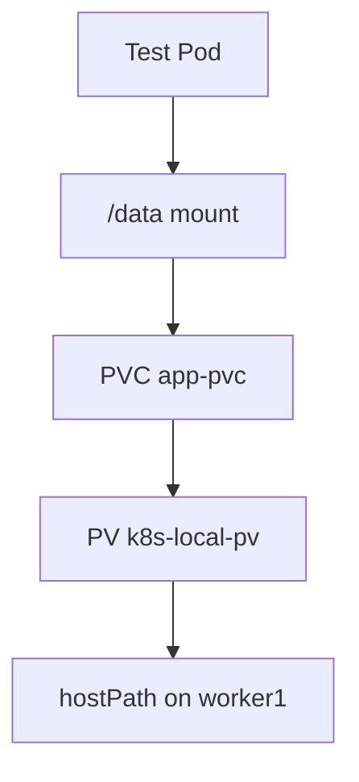
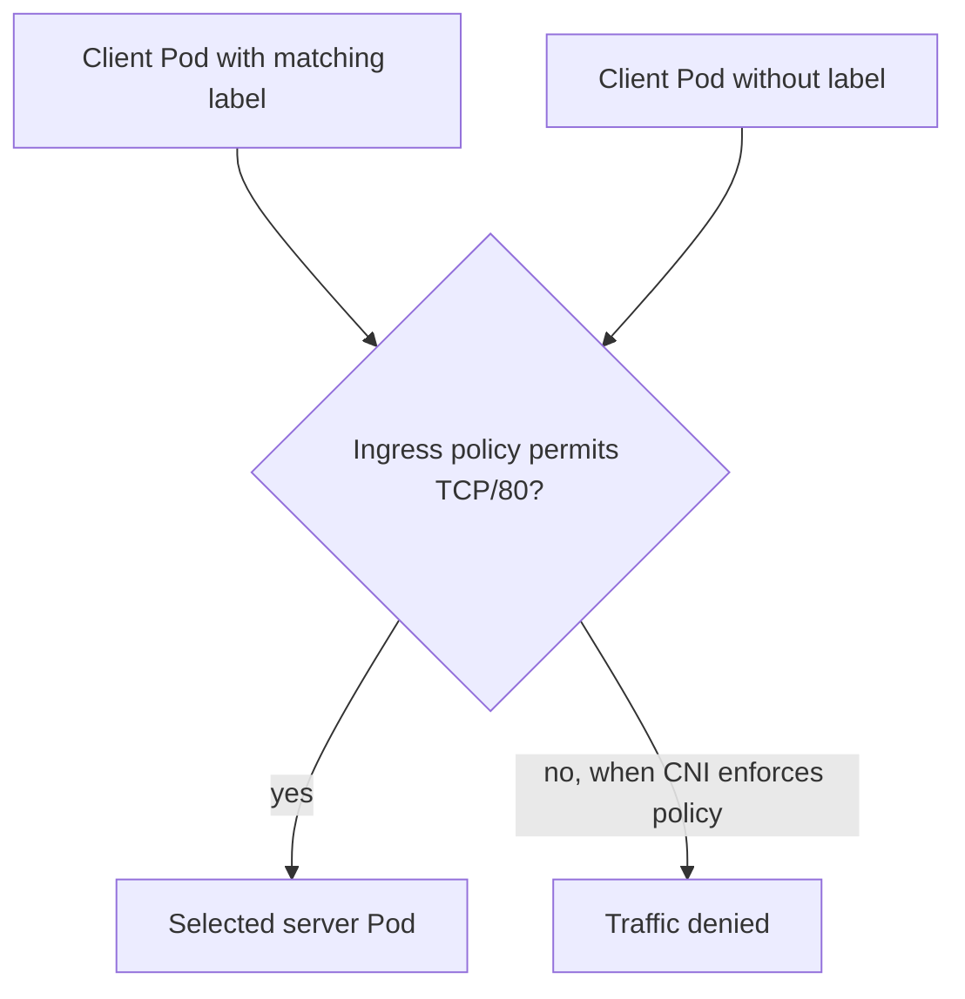
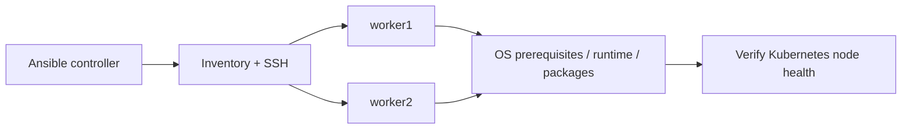

# Architecture Diagrams

These Mermaid diagrams describe the recorded lab design. The CNI changed over time, so Flannel is historical and later notes record Calico v3.33.0. Confirm the active cluster state before using a diagram as an as-built inventory. LAN node addresses are intentionally masked.

## Full cluster

## Service traffic and DNS

## NodePort / kube-proxy packet path

This shows the iptables-based path observed in the lab. Chain names and dataplane differ across Kubernetes configurations.

## LoadBalancer with MetalLB

## Monitoring and alerting

## Persistent storage

## NetworkPolicy logic

## Ansible workflow

